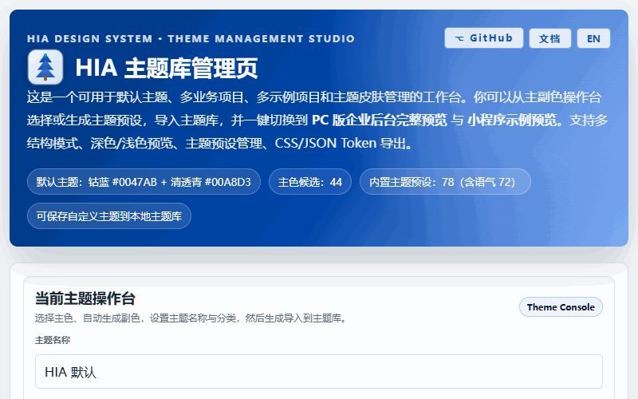
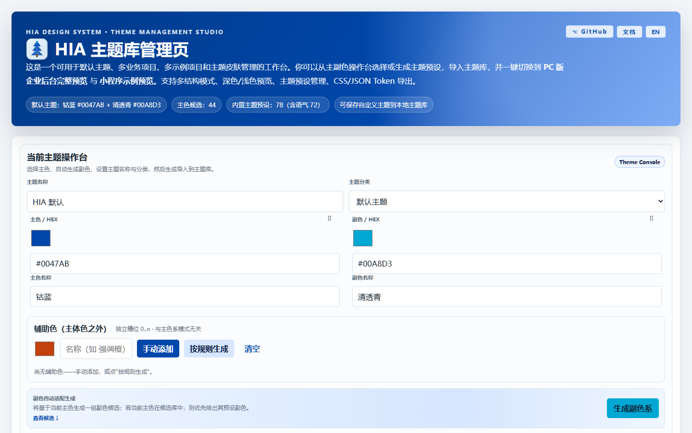
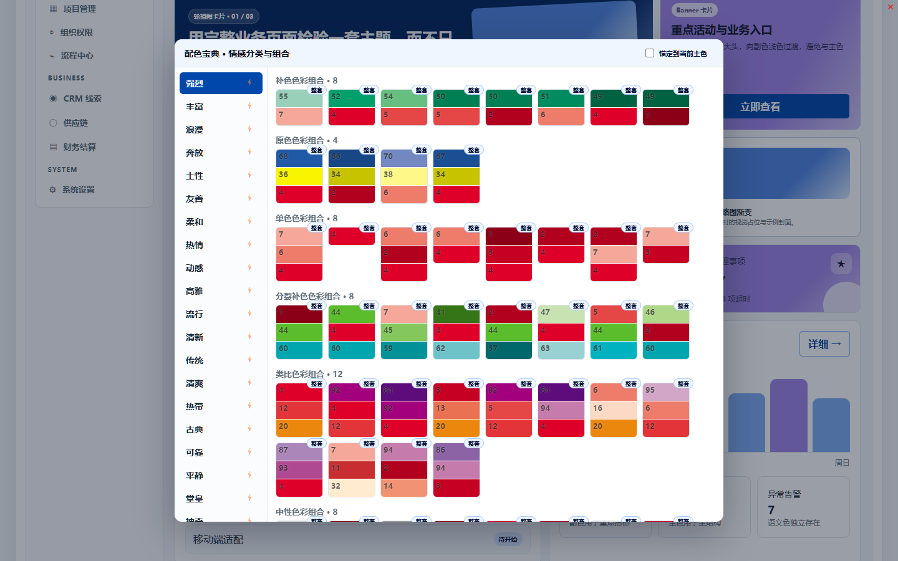
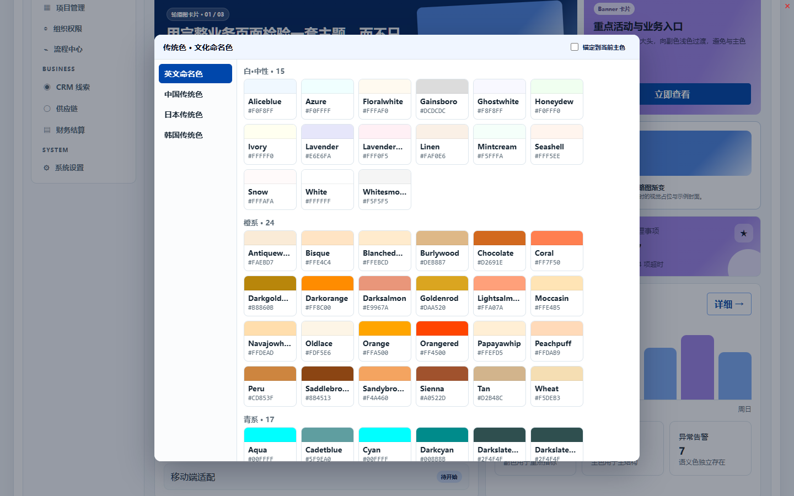
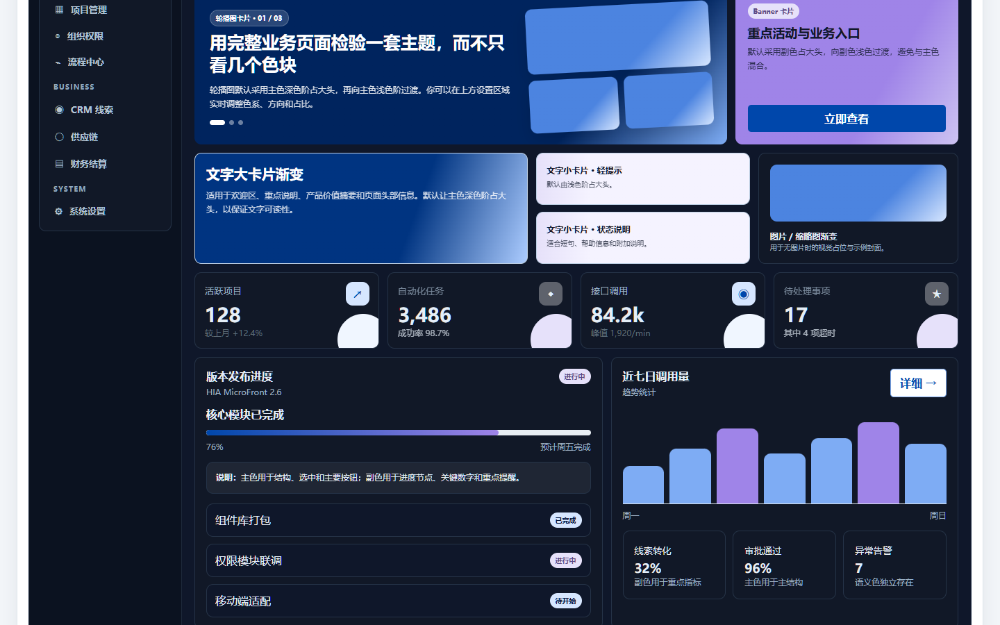

# HIA-Theme-Builder

[English](README.md) | 简体中文

HIA 主题构建器。将原始的 `HIA_theme_manager.html` 单一 HTML 工具，以 TypeScript + 组件化的方式重构为一套可复用、可发布的主题管理体系，并抽离公共核心（`core`），在其基础上派生出网页版、Electron 版与 Tauri 版。

**当前版本 [v0.6.0](https://github.com/mandolin/HIA-Theme-Builder/releases/tag/v0.6.0)**（2026-11-13）：质量深化与契约成熟 · [在线版（GitHub Pages）](https://mandolin.github.io/HIA-Theme-Builder/) · [文档子站](https://mandolin.github.io/HIA-Theme-Builder/docs/) · [桌面下载](https://github.com/mandolin/HIA-Theme-Builder/releases)

## 演示

完整工作流一屏看完（从生产构建录制，脚本自动生成、可复跑）：选主色 → 生成配色 → 宝典组合 → 六类色源 → 英文界面 → 滤镜 → 深色模式 → 导出。

| | |
| --- | --- |
|  |  |
|  |  |

更多静态图见 [`promo/screenshots/`](promo/screenshots) · Product Hunt 画廊图：[`promo/ph-gallery-1270x760.png`](promo/ph-gallery-1270x760.png)。

## 功能总览

- **主题操作台**：主色候选库（44 色）、副色候选区、名称/分类/行业元信息；一键应用/生成导入主题库。
- **配色关系模式与辅助色**（ADR-007 v2）：主体色单色/双色/三色模式（成员数派生）；十种经典配色设计映射为关系规则（互补/冲突/中性/类比/分裂补色/三次色/原色组合/二次色组合/纯色/手动）；规则补副色/补第三色；辅助色独立槽位（0..8，手动添加/按规则生成/↔主副三互换/拖拽排序）。
- **配色宝典选色**：弹层内置 24 情感分类 × 10 形态组合（1440 组合/3739 色条，逐页对账零缺失），点击组合一键套用主体色；情感行 ⚡ 快捷套用。
- **六源选色**：宝典组合 / 传统色 1,637 色（英/中/日/韩，含说明）/ 国旗 196 国与地区（内置旗帜图）/ 企业品牌色 691（内置 logo）/ 自然场景 41 / 社会场景 31——经“宝典选色”下拉切换。
- **语气预设与锚定**：72 个内置情感预设成套套用；锚定模式以当前主色重推导组合成员。
- **预览滤镜族**：透明度淡化 / 低饱和 / 亮度增减 / 灰度 25-50-100%，仅影响预览并记忆选择。
- **取色探索**：桌面端输入网址真实渲染取色（多信号加权：主色/Logo/manifest 等），SSRF 双重校验（Electron 主进程 + Tauri Rust CDP 逐请求拦截）。
- **预览**：PC 版企业后台完整预览（仪表盘/列表/表单/详情/分析/设置六页 × 左右/上下/混合三结构 × 明暗双模式）+ 小程序五页示例预览 + WordPress/Tailwind 经典场景注入预览。
- **渐变**：8 渐变角色 × 色系来源（主/副/第三/辅助 N）× 色阶/角度/偏置，自定义下拉带色块预览。
- **导出**：CSS 变量 / JSON Token / WordPress theme.json+子主题骨架 / Tailwind 配置；第三色与辅助色全量传导。
- **主题市场**：本地库管理（搜索/分类/行业筛选）、导入导出主题包、分享链接（URL 还原主题）、远程预设源（官方示例源内置）。
- **国际化与无障碍**：中/英双语界面（含演示内容翻译），ARIA/键盘可达基线。

| 入口 | 说明 |
| --- | --- |
| 网页版 (`HIA/web`) | 在线主题构建与预览，发布到 GitHub Pages；共享渲染器为三端 UI 单一事实来源。 |
| Electron 版 (`HIA/electron`) | 桌面版，复用 web 共享渲染器，启动即为一致操作台/预览/渐变/导出，并具备从指定网址获取颜色集等额外能力。 |
| Tauri 版 (`HIA/tauri`) | 桌面版（更轻量），复用 web 共享渲染器，启动即为一致操作台/预览/渐变/导出，并具备从指定网址获取颜色集等额外能力。 |
| 公共核心 (`HIA/core`) | 供以上各端调用的公共主题模型、颜色算法、Token 导出与预览组件。 |

> 跨端一致性：桌面端不重写 UI，直接复用 `HIA/web` 的 Vite 构建产物（`index.html` + `assets`），因此三端呈现与操作一致；桌面端专属能力（从网址取色）通过各自平台桥（`window.hia.extractFromUrl` / `__TAURI_INVOKE__('extract_signals')`）由 `createAdaptivePlatform` 的回退链自动接入。
>
> 取色算法同源：Electron 注入与 Tauri 编译期 `include_str!` 嵌入的 scanner bundle 均来自同一份 `HIA/extractor/dist/browser-scanner.bundle.js`（IIFE 自包含），且 Electron 运行期读取 `node_modules/@hia/theme-url-extractor/dist/` 副本须与其内容一致。可用 `HIA/extractor/scripts/verify-bundle-consistency.mjs` 校验三端 bundle 内容 hash 一致，保证评分可复现。

## 仓库与边界

本项目是一个 mono-repo，顶层文件夹 `HIA-Theme-Builder/` 自身是**公开主库**（映射到 `mandolin/HIA-Theme-Builder`）；`work-zone/` 是独立**私有工作区库**（映射到 `mandolin/HIA-Theme-Builder-WorkZone`），被主库根 `.gitignore` 排除。

| 位置 | 职责 | 仓库 |
| --- | --- | --- |
| `HIA/core/` | 公共主题模型、配色算法、Token 导出、可复用预览组件。 | 主库（公开） |
| `HIA/web/` | 网页版应用，部署 GitHub Pages。 | 主库（公开） |
| `HIA/electron/` | Electron 桌面版，复用 web 共享渲染器，含网址取色等能力。 | 主库（公开） |
| `HIA/tauri/` | Tauri 桌面版，复用 web 共享渲染器，含网址取色等能力。 | 主库（公开） |
| `docs/` | 面向使用者和二次开发者的公开文档。 | 主库（公开） |
| `dev/` | 已整理、可公开的开发材料入口（可为空）。 | 主库（公开） |
| `work-zone/` | 私有规划、研究、审计、评审与 AI 协作证据。 | 私有库（不公开） |

根目录刻意不建立跨 `HIA/*` 的共享依赖树或统一构建流水线；各端独立包管理、测试与发布。跨端联调使用 `HIA/core` 的本地包链接、示例或 fixtures。

## 原始工具

重构起点为内部单文件工具 `HIA_theme_manager.html`：一个以主/副色操作台、预设主题库、渐变设置、PC/小程序预览和 CSS/JSON Token 导出为核心的单文件工作台。本项目在保留其设计语言与能力边界的前提下，进行组件化拆分与多端派生。

## 规划与里程碑

公开侧仅保留定位与能力说明。规划、周期（`W-*`/`C-*`）、里程碑（`M-*`）、ADR、审计与 AI 协作记录统一位于私有 `work-zone/`；公开 `docs/` 不复制内部过程材料。

## 开发环境

- 推荐使用 [mise](https://mise.jdx.dev/) 统一工具链：根目录 `.mise.toml` 已锁定 Node 22（LTS），本地与 CI 版本保持一致。克隆后执行 `mise install` 即自动安装匹配运行时。
- Shell 工作在 Windows 上统一使用 PowerShell 7（`C:\Program Files\PowerShell\7\pwsh.exe`）；`mise run` 任务（如 `build-web`/`test-core`/`test-ssrf`）可一键执行常见流程。
- 各端在对应目录下独立安装与构建；具体内容见各端 README。

## 中英双语代码文档

自首份源码起，所有代码语义节点均执行 ROP（面向阅读的编程），具备紧邻的中英双语文档化注释；JS/TS 当前使用 `@lang zh-CN`、`@lang en` 与 inline `<lang>`。详见 `AGENTS.md`。

## 字体策略

默认 UI、示例、测试与生成产物只使用来源与许可证明确的开源字体或 generic fallback；闭源或来源不明字体只作为兼容输入，不作默认值或打包资产。

## 构建与发布

三端各自构建与发布，版本号相互独立。

- **网页版（`HIA/web`）**：`npm install && npm run build`（`GITHUB_PAGES=1` 时基路径适配）；产物部署到 GitHub Pages（`.github/workflows/pages.yml` 在 `main` 推送时自动构建四端并部署 `web/dist`）。
- **Electron 版（`HIA/electron`）**：`npm install && npm run build` 编译；`npm run dist` 用 `electron-builder` 产出**便携版** `dist/HIA-Theme-Builder-Electron-<ver>-portable.exe`（内置运行时，双击即用）。
- **Tauri 版（`HIA/tauri`）**：`npm install`（含 `@tauri-apps/cli`）→ `npm run build`（`build:front` + `tauri build`）；release 产物为独立便携 `exe`（`src-tauri/target/release/`，需系统 WebView2 Runtime）。

桌面端产物为**未签名便携版**（自签名证书签名，运行时可能提示发布者验证），运行时会提示"未知发布者"时选择"仍要运行"。GitHub Release 聚合桌面端产物（Electron 便携+安装器、Tauri 便携+MSI，附 SHA-256 校验和），网页版经 Pages 分发。

### v0.3.0 发布内容（2026-11-10）

- 配色关系模式与辅助色（十种设计规则、三模式派生、宝典选色弹层、辅助色槽位管理）；
- 配色机制 UX 完善（操作台修正、成员卡管理、拖拽互换、候选卡双/三/全色三态、24 情感一键套用）；
- 主题市场（分享链接/导入导出/远程源）与 CMS 适配产出（WP/Tailwind/TDON v0）；
- 中英双语界面全面清查（0 残留）；三端哈希一致性保证（渲染器 SHA256 逐位一致）。

## 许可证

本项目采用**混合许可证**策略：

- 根文档及 `HIA/core`、`HIA/web`、`HIA/tauri` 默认按 **MIT License** 授权。
- `HIA/electron/` 目录采用 **Apache License 2.0**（子包自决；因其“从指定网址获取颜色集”等额外能力可能引入 Apache-2.0 依赖，且专利授权对企业分发更友好）。具体见根 `LICENSE`；许可证审计记录位于私有 WorkZone。
- `work-zone/` 为独立私有仓库，不随公开主库授权分发。

所有第三方依赖、字体、图标与二进制资产进入发布路径前须记录来源、版本与许可证，优先 MIT、Apache-2.0、BSD、ISC、OFL、CC0 等宽松许可。
